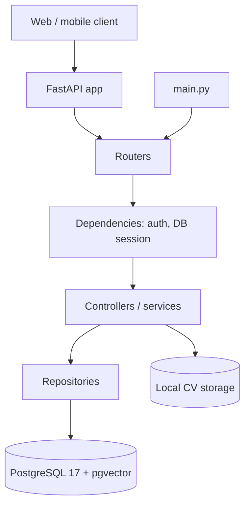

# FlowWise

**AI-assisted recruitment backend: CV ingestion, HR workspace, job postings and a candidate application pipeline.**

FastAPI · PostgreSQL 17 · SQLAlchemy 2 (async) · Alembic · JWT + RBAC · Docker

> **Status:** the project is under active refactoring. Read
> [Repository status](#repository-status) before running the start commands —
> the working tree currently needs a small set of fixes before the API boots.

---

## Table of contents

- [Overview](#overview)
- [Features](#features)
- [Tech stack](#tech-stack)
- [Architecture](#architecture)
- [Project structure](#project-structure)
- [API reference](#api-reference)
- [Roles and permissions](#roles-and-permissions)
- [Getting started](#getting-started)
- [Environment variables](#environment-variables)
- [Database and migrations](#database-and-migrations)
- [Repository status](#repository-status)
- [Cleanup checklist](#cleanup-checklist)
- [Roadmap](#roadmap)
- [Contributing](#contributing)
- [Team](#team)
- [License](#license)

---

## Overview

FlowWise is the backend of a recruitment platform with three actors:

- **Candidates** browse published jobs and submit an application with a CV.
- **HR Members** maintain a job-title catalog, create and publish postings, and
  review applicants through a hiring pipeline.
- **HR Admins** own the company, manage HR Member accounts (create, approve,
  decline, disable, delete) and have read-only oversight of postings and
  applicants.

The backend is a modular FastAPI service with routers → controllers → repositories,
async SQLAlchemy models and versioned Alembic migrations. Authentication is
JWT-based with a role/company claim set, and every HR request re-loads the user
from the database so approvals, disabling and password changes take effect
immediately.

---

## Features

### Implemented and working

| Feature | Description |
| --- | --- |
| HR Admin registration | Creates a company and its single HR Admin in one transaction, returns a JWT. |
| JWT authentication | Login, `me`, password change; bcrypt hashing, 72-byte rule, dummy-hash comparison against user enumeration, `token_version` invalidation. |
| RBAC | `ADMIN` / `MEMBER` roles, partial unique index enforcing one admin per company, router-level dependencies. |
| HR Member lifecycle | Create (PENDING) → approve / decline / disable / delete, with guards around accounts that own postings. |
| Company profile | Read and update name, description, address, phone, email with uniqueness checks. |
| Job-title catalog | CRUD, case-insensitive uniqueness per company, delete blocked while used by a posting. |
| Postings | Create as DRAFT, edit, publish, close; company-scoped listing with filters and applicant counts. |
| Applicant review | List applicants per posting, applicant detail with parsed CV payload and allowed next statuses, pipeline transitions. |
| Public application | Multipart apply endpoint: find-or-create candidate by email, SHA-256 CV deduplication, application record. |
| CV upload (legacy) | PDF validation (type, size, extractable text) with project-based local storage. |
| Database | Async engine, Alembic migrations, typed enums, JSONB job requirements. |
| Docker | PostgreSQL 17 + pgvector image and pgAdmin via Compose. |

### Partial / needs work

| Feature | State |
| --- | --- |
| Public job listing | Endpoint exists but the status filter compares `"published"` against a column that stores `PUBLISHED`, so it always returns an empty list. |
| Job requirements API | Model, JSONB column and repository exist; no HTTP routes. |
| CV processing | `POST /api/v1/cv/process/{file_id}` is an empty stub. |
| CV download | HR receives a `file_path` string but there is no authenticated endpoint to fetch the file. |
| Semantic search / matching | pgvector is available in the database image, but no embedding column, extension setup or matching code exists. |
| Legacy candidate API | `/api/candidates` and `/api/cv-files` are wired to a service layer that is currently missing from the working tree (see [Repository status](#repository-status)). |

---

## Tech stack

| Category | Technology |
| --- | --- |
| Framework | FastAPI 0.110.2 |
| ASGI server | Uvicorn 0.29.0 |
| Database | PostgreSQL 17 (`pgvector/pgvector:0.8.0-pg17` image) |
| ORM | SQLAlchemy 2.0.29 (async, `asyncpg` 0.29.0) |
| Migrations | Alembic 1.13.1 |
| Validation / settings | Pydantic 2 + pydantic-settings 2.10.1 |
| Auth | PyJWT 2.9.0, passlib 1.7.4, bcrypt 4.0.1 |
| PDF | PyMuPDF 1.28.2, langchain-community parsers |
| Files | aiofiles 25.1.0, python-multipart 0.0.9 |
| Infrastructure | Docker Compose (PostgreSQL + pgAdmin) |

Runtime target: **Python 3.12** (pin this; 3.13 is not validated with the pinned
dependencies).

---

## Architecture



Request flow:

1. Router receives the request and resolves dependencies (JWT → `HRUser`, DB session).
2. Controller/service applies business rules and company scoping.
3. Repository builds the SQLAlchemy query and flushes.
4. The controller commits the transaction.
5. Pydantic schema serializes the response.

Design rules the code follows (where it is consistent):

- Every HR lookup is scoped by `company_id`; a foreign resource returns **404**, not 403, so IDs cannot be probed.
- Repositories only `flush()`; controllers own `commit()`/`rollback()`.
- The role in the JWT is never trusted alone — the user is reloaded and checked against `role`, `company_id`, `token_version` and `status`.

---

## Project structure

Current tree (after the cleanup in [Cleanup checklist](#cleanup-checklist)):

```plaintext
project/
├── Docker/
│   ├── docker-compose.yml        # PostgreSQL 17 + pgvector, pgAdmin
│   ├── .env.example
│   └── .gitignore
├── src/
│   ├── main.py                   # FastAPI app, CORS, router registration
│   ├── requirements.txt
│   ├── .env.example
│   ├── assets/                   # legacy CV storage (assets/files/{project_id}/)
│   ├── controllers/              # business logic
│   │   ├── Base_controller.py
│   │   ├── cv_controller.py
│   │   ├── project_controller.py
│   │   ├── candidate_controller.py
│   │   ├── cv_file_controller.py
│   │   ├── job_controller.py
│   │   ├── hr_auth_controller.py
│   │   ├── hr_admin_controller.py
│   │   └── hr_member_controller.py
│   ├── helpers/                  # config, security, RBAC, errors, time utils
│   ├── models/
│   │   ├── db/
│   │   │   ├── connection_database.py
│   │   │   └── flow_wise/
│   │   │       ├── alembic/      # env.py + versions/
│   │   │       └── schema/       # SQLAlchemy models
│   │   └── enums/
│   ├── repositories/             # data access
│   ├── routes/                   # API routers
│   ├── schema/                   # Pydantic request/response models
│   └── tests/                    # currently unversioned and out of date
├── .gitignore
├── LICENSE
└── README.md
```

Runtime uploads do **not** belong under `src/`. The target is a single gitignored
`data/` directory outside the package (see the cleanup checklist).

---

## API reference

Base URL: `http://localhost:8000`. Interactive docs: `/docs`, `/redoc`.

### Health

| Method | Path | Auth | Description |
| --- | --- | --- | --- |
| GET | `/` | none | Welcome message. |

### HR authentication — `/api/v1/hr/auth`

| Method | Path | Auth | Description |
| --- | --- | --- | --- |
| POST | `/register-admin` | none | Create a company + its ADMIN. Controlled by `ALLOW_ADMIN_REGISTRATION`. |
| POST | `/login` | none | OAuth2 password form; `username` = email. Returns JWT + role. |
| GET | `/me` | any HR | Current account. |
| POST | `/change-password` | any HR | Verify current password, bump `token_version`, return a new JWT. |

### HR Admin — `/api/v1/hr/admin`

All routes require `role = admin`.

| Method | Path | Description |
| --- | --- | --- |
| GET | `/company` | Own company profile. |
| PATCH | `/company` | Update profile (name/email uniqueness enforced). |
| POST | `/members` | Create a MEMBER account (starts PENDING). |
| GET | `/members` | Paginated members; `status`, `search`, `limit`, `offset`. |
| GET | `/members/{member_id}` | Member detail. |
| PATCH | `/members/{member_id}` | Update name/email; sending `password` resets it and invalidates sessions. |
| POST | `/members/{member_id}/approve` | PENDING → ACTIVE. |
| POST | `/members/{member_id}/decline` | PENDING → DECLINED. |
| POST | `/members/{member_id}/disable` | ACTIVE → DISABLED. |
| DELETE | `/members/{member_id}` | Delete; refused if the member owns postings. |
| GET | `/postings` | Read-only postings list (with applicant counts). |
| GET | `/postings/{job_id}` | Read-only posting detail. |
| GET | `/postings/{job_id}/applicants` | Applicant list. |
| GET | `/applicants/{application_id}` | Applicant detail incl. parsed CV. |

### HR Member — `/api/v1/hr`

Requires `member` or `admin`.

| Method | Path | Description |
| --- | --- | --- |
| POST | `/job-titles` | Create a job title. |
| GET | `/job-titles` | List (search, pagination). |
| GET | `/job-titles/{title_id}` | Detail. |
| PATCH | `/job-titles/{title_id}` | Update. |
| DELETE | `/job-titles/{title_id}` | Delete; blocked while used by a posting. |
| POST | `/postings` | Create a posting as DRAFT. |
| GET | `/postings` | List; `status`, `job_title_id`, `mine`, pagination. |
| GET | `/postings/{job_id}` | Detail. |
| PATCH | `/postings/{job_id}` | Update; closed postings are immutable. |
| POST | `/postings/{job_id}/open` | Publish. |
| POST | `/postings/{job_id}/close` | Close. |
| GET | `/postings/{job_id}/applicants` | Applicants; `status`, pagination. |
| GET | `/applicants/{application_id}` | Applicant detail. |
| PATCH | `/applicants/{application_id}/status` | Move forward in the pipeline or reject. |

Pipeline: `not_received → received → screened → shortlisted → interview → offer → hired`,
with `rejected` allowed at any non-final step. `hired` and `rejected` are terminal.

### Public jobs — `/api/v1/jobs`

| Method | Path | Auth | Description |
| --- | --- | --- | --- |
| POST | `/{job_id}/apply` | none | Multipart application: `full_name`, `email`, `phone`, `education`, `portfolio`, `cv_file`. Creates/reuses candidate by email, deduplicates CV by SHA-256, creates an application. |

### CV — `/api/v1/cv`

| Method | Path | Auth | Description |
| --- | --- | --- | --- |
| POST | `/upload/{project_id}` | none | Validate a PDF CV and store it under the project folder. |
| POST | `/process/{file_id}` | none | **Stub** — not implemented. |

### Candidates and CV files (legacy)

| Method | Path | Auth | Description |
| --- | --- | --- | --- |
| POST | `/api/candidates/` | none | Create candidate. |
| GET | `/api/candidates/{candidate_id}` | none | Candidate by ID. |
| GET | `/api/candidates/email/{email}` | none | Candidate by email. |
| PATCH | `/api/candidates/{candidate_id}/status` | none | Update candidate status. |
| DELETE | `/api/candidates/{candidate_id}` | none | Delete candidate. |
| POST | `/api/cv-files/upload/{candidate_id}` | none | Upload a CV through the service/storage layer. |

These routes are unauthenticated and currently broken. Either protect and keep
them, or delete them in favour of the public apply flow (recommended).

### Jobs (legacy) — `/api/jobs`

Superseded by `/api/v1/hr/postings`. Do not build new clients against this API.

| Method | Path | Auth | Description |
| --- | --- | --- | --- |
| POST | `/api/jobs` | HR | Create a job + first requirement. |
| GET | `/api/jobs` | HR | List jobs — **not company-scoped**. |
| PATCH | `/api/jobs/{job_id}/status` | HR | Update status — **no ownership check**. |
| GET | `/api/jobs/{job_id}/with-applications` | HR | Job + applications — **no company check**. |
| GET | `/api/jobs/public` | none | Published jobs — **currently always empty** (enum bug). |

---

## Roles and permissions

| Capability | Public | Member | Admin |
| --- | --- | --- | --- |
| Browse published jobs | yes | yes | yes |
| Apply to a job | yes | yes | yes |
| Manage job titles / postings | no | yes | yes |
| Review applicants and move pipeline | no | yes | yes |
| Read postings / applicants (oversight) | no | yes | yes |
| Manage company profile | no | no | yes |
| Create / approve / decline / disable / delete members | no | no | yes |
| Register a new company | controlled by `ALLOW_ADMIN_REGISTRATION` | — | — |

---

## Getting started

### Prerequisites

- Python 3.12
- Docker + Docker Compose
- Git

### 1. Clone and create an environment

```bash
git clone https://github.com/ahmedmontaser123/flow_wise_platform.git
cd flow_wise_platform/project

python3.12 -m venv .venv
source .venv/bin/activate        # Windows: .venv\Scripts\activate
pip install --upgrade pip
pip install -r src/requirements.txt
```

### 2. Configure environment files

```bash
cp src/.env.example src/.env
cp Docker/.env.example Docker/.env
```

Edit both files; the database credentials must match. See
[Environment variables](#environment-variables).

### 3. Start the database

```bash
docker compose --env-file src/.env -f Docker/docker-compose.yml up -d
docker compose --env-file src/.env -f Docker/docker-compose.yml ps
```

- PostgreSQL: `localhost:5432`
- pgAdmin: `http://localhost:5050`

### 4. Apply migrations

Run from the repository root — the Alembic config uses a path relative to the
working directory:

```bash
alembic -c src/models/db/flow_wise/alembic.ini upgrade head
```

> The configuration in `src/models/db/flow_wise/alembic.ini` points at
> `script_location = src/models/db/flow_wise/alembic`. Running `alembic` from
> inside that folder (as older docs suggested) will not find the scripts.

### 5. Run the API

From the repository root:

```bash
uvicorn main:app --app-dir src --reload --host 0.0.0.0 --port 8000
```

- API: `http://localhost:8000`
- Swagger: `http://localhost:8000/docs`
- ReDoc: `http://localhost:8000/redoc`

### 6. Stop

```bash
docker compose --env-file src/.env -f Docker/docker-compose.yml down
# add -v to delete the database volume
```

---

## Environment variables

`src/.env` (read by `helpers/config.py` and `helpers/hr_auth_settings.py`):

| Variable | Required | Default | Purpose |
| --- | --- | --- | --- |
| `POSTGRES_USER` | yes | — | Database user. |
| `POSTGRES_PASSWORD` | yes | — | Database password. |
| `POSTGRES_DB` | yes | — | Database name. |
| `POSTGRES_HOST` | no | `localhost` | Database host. |
| `POSTGRES_PORT` | no | `5432` | Database port. |
| `PGADMIN_DEFAULT_EMAIL` | yes* | — | pgAdmin login (not used by the API). |
| `PGADMIN_DEFAULT_PASSWORD` | yes* | — | pgAdmin password (not used by the API). |
| `PGADMIN_PORT` | no | `5050` | pgAdmin port (not used by the API). |
| `CHUNK_SIZE` | no | `512000` | Upload stream chunk size in bytes. |
| `JWT_SECRET_KEY` | yes | — | Signing key, minimum 32 chars. Generate with `python -c "import secrets; print(secrets.token_urlsafe(48))"`. |
| `JWT_ALGORITHM` | no | `HS256` | JWT algorithm. |
| `ACCESS_TOKEN_EXPIRE_MINUTES` | no | `60` | Access-token lifetime. |
| `ALLOW_ADMIN_REGISTRATION` | no | `true` | Set to `false` once real companies exist. |
| `CV_STORAGE_PATH` | no | `../data_storage/cv_files` | CV storage directory (see the cleanup checklist). |

\* Required by the current `Settings` model even though only Docker uses them;
merge them into one settings class and drop the requirement.

`Docker/.env` only needs the five `POSTGRES_*` / `PGADMIN_*` values used by Compose.

Unused leftovers still present in `src/.env`: `GROQ_API_KEY`, `GROQ_API_URL`,
`COHERE_*`, `HUGGINGFACE_*`, `GENERATION_*`, `INPUT_MAX_CHARACTER`,
`MAX_OUTPUT_TOKENS`, `TEMPERATURE`. Nothing reads them; remove or restore the
LLM pipeline.

> Never commit `.env` files. They are ignored by `.gitignore`; only
> `.env.example` belongs in git.

---

## Database and migrations

Models live in `src/models/db/flow_wise/schema/`; migrations in
`src/models/db/flow_wise/alembic/versions/`.

Current revision chain:

```plaintext
0db38c0491ba  initial schema
   └── bdf653dcab64  applications cleanup + unique (cv_file_id, job_id)
          └── aa7da30d5100  job_requirements → JSONB schema_definition
                 └── c3f1a9e7b2d4  HR RBAC, one-admin index, job_titles, jobs.job_title_id
```

Commands (from the repository root):

```bash
alembic -c src/models/db/flow_wise/alembic.ini current
alembic -c src/models/db/flow_wise/alembic.ini upgrade head
alembic -c src/models/db/flow_wise/alembic.ini revision --autogenerate -m "describe change"
alembic -c src/models/db/flow_wise/alembic.ini downgrade -1
```

Known schema gaps to fix before relying on a fresh database:

- `cv_files.file_hash` is used by the application but is missing from every migration.
- `companies.email` is unique in the model but not in the initial migration.
- Enum columns store the Python member **name** (`PUBLISHED`), so compare against
  enum members, never against `.value` strings.
- `job_requirements` has no unique constraint on `job_id`, although the code
  treats it as one requirement per job.

---

## Repository status

The repository is **not runnable in its current state**:

1. `src/services/` and `src/storage/` were deleted from the working tree while
   `controllers/candidate_controller.py` and `controllers/cv_file_controller.py`
   still import them. `uvicorn` fails at import time.
2. Imports use two roots: top-level (`models.*`, `schema.*`) and `src.*`.
   `src/main.py` inserts `src/` on `sys.path`, so `src.*` cannot resolve; running
   from the repository root breaks the top-level imports instead.
3. `src/schema/job_schema.py` imports `src.schema.application_schema`, breaking
   the `/api/jobs` chain under the `src/` working directory.
4. Tests in `src/tests/` are untracked and import modules that no longer exist
   (`controllers.process_controller`, `helpers.json_utils`, `stores.LLM.*`).
5. 91 files differ from `HEAD` only by CRLF line endings.

Until these are fixed, use the fix order in the next section.

---

## Cleanup checklist

### Restore (do not delete)

- [ ] `git checkout -- src/services src/storage` if the candidate/CV-file APIs
      are kept. Otherwise delete `routes/candidate_route.py`,
      `routes/cv_file_route.py`, `controllers/candidate_controller.py`,
      `controllers/cv_file_controller.py` and the repositories/schemas that only
      they use, together.

### Delete — dead or broken

- [ ] `src/stores/` — only stale `__pycache__` remains; the LLM sources are gone.
- [ ] `src/tests/` — untracked and imports missing modules (or restore the LLM
      feature on its own branch and move the tests there).
- [ ] `src/assets/files/{project_id}/` — literal placeholder folder.
- [ ] Every `__pycache__/` directory.
- [ ] `uploads/cvs/*.pdf` — real candidate CVs are tracked in git. Remove them,
      add `uploads/` to `.gitignore`, and purge them from history if the repo was
      ever public.
- [ ] Commit the already-deleted `HR_INTEGRATION.md` and `project_structure.txt`.

### Delete — after consolidating on the newer stack

- [ ] Legacy jobs: `routes/job_router.py`, `controllers/job_controller.py`,
      `repositories/job_repository.py`, `schema/job_schema.py`,
      `schema/application_schema.py`.
- [ ] Legacy CV upload: `routes/cv_router.py`, `controllers/cv_controller.py`,
      `controllers/project_controller.py`, `controllers/Base_controller.py`.
- [ ] Duplicate HR repositories: `repositories/company_repository.py`,
      `repositories/hr_users_repository.py` and their schemas.
- [ ] Unused repositories once their APIs are gone: `candidate_repository.py`,
      `cv_file_repository.py`, `cv_parsed_repository.py`,
      `job_requirement_repository.py` (unless the requirements API is added).
- [ ] Unused enums: `candidate_enum.py`, `requirement_type_enum.py`,
      `file_content_enum.py`, `response_signal.py`.
- [ ] `repositories/__init__.py` (it re-exports a model, and eagerly imports
      every repository).
- [ ] Decide on `.vscode/settings.json`: it is tracked while `.vscode/` is
      gitignored.

### Add

- [ ] `.gitattributes` with `* text=auto eol=lf`, then `git add --renormalize .`.
- [ ] `pyproject.toml` (deps, `ruff`, `pytest` with `pythonpath = ["src"]`).
- [ ] `uploads/`, `data/`, `*.pdf` runtime storage to `.gitignore`.
- [ ] An app `Dockerfile` and a healthcheck on the database service.
- [ ] A migration for `cv_files.file_hash` (and the `companies.email` unique
      constraint).
- [ ] `GET /health` / `GET /ready` with a database ping.
- [ ] An authenticated, company-scoped CV download endpoint.
- [ ] Public posting list/detail endpoints backed by `JobStatus.PUBLISHED`.

---

## Roadmap

- [x] Foundation — schema, models, repositories, configuration.
- [x] HR authentication and RBAC (company, admin, members).
- [x] Job-title catalog and postings lifecycle.
- [x] Applicant review and hiring pipeline.
- [x] Public application endpoint.
- [x] CV ingestion and PDF validation.
- [ ] Consolidate the job/posting APIs and the CV storage layer.
- [ ] CV text extraction and structured parsing (NuExtract / LLM providers).
- [ ] Embeddings and semantic search with pgvector.
- [ ] Job–candidate matching engine with weighted requirements.
- [ ] Analytics dashboard and pipeline metrics.
- [ ] Automated tests, CI and containerised API.

---

## Contributing

1. Fork the repository.
2. Create a branch: `git checkout -b feature/your-feature`.
3. Follow PEP 8 and the existing router → controller → repository layering.
4. Scope every HR query by `company_id`.
5. Add a migration for every schema change and test it against a fresh database.
6. Write tests for new behaviour.
7. Open a pull request.

---

## Team

| Contributor | GitHub |
| --- | --- |
| ahmedmontaser123 | [@ahmedmontaser123](https://github.com/ahmedmontaser123) |
| mohossam123322-ui | [@mohossam123322-ui](https://github.com/mohossam123322-ui) |
| saif-yousry | [@saif-yousry](https://github.com/saif-yousry) |
| ah3asef | [@ah3asef](https://github.com/ah3asef) |
| Mostafa Abdelkader | [@MostafaAbdelkader](https://github.com/MostafaAbdelkader) |
| Abobakr | [@Abobakr](https://github.com/Abobakr) |

---

## License

Apache License 2.0 — see [LICENSE](LICENSE).

```text
Copyright 2026 FlowWise Contributors

Licensed under the Apache License, Version 2.0 (the "License");
you may not use this file except in compliance with the License.
You may obtain a copy of the License at

    http://www.apache.org/licenses/LICENSE-2.0

Unless required by applicable law or agreed to in writing, software
distributed under the License is distributed on an "AS IS" BASIS,
WITHOUT WARRANTIES OR CONDITIONS OF ANY KIND, either express or implied.
See the License for the specific language governing permissions and
limitations under the License.
```
