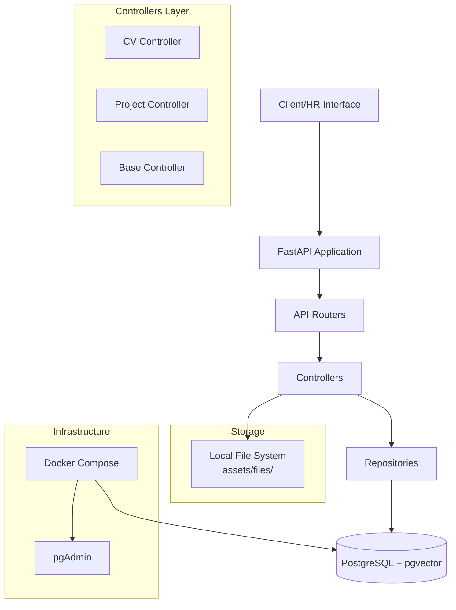

<div align="center">

# FlowWise

**AI-Powered Recruitment Platform for Intelligent CV Screening & Candidate Matching**

[](https://www.python.org/downloads/)
[](https://fastapi.tiangolo.com/)
[](https://www.postgresql.org/)
[](https://github.com/pgvector/pgvector)
[](https://www.sqlalchemy.org/)
[](https://alembic.sqlalchemy.org/)
[](https://docs.docker.com/compose/)
[](LICENSE)

[Overview](#overview) • [Features](#features) • [Tech Stack](#tech-stack) • [Architecture](#architecture) • [Database Schema](#database-schema) • [Getting Started](#getting-started) • [API Reference](#api-reference) • [Roadmap](#roadmap) • [Contributing](#contributing) • [Team](#team) • [License](#license)

</div>

---

## Overview

FlowWise is an AI-powered recruitment platform designed to streamline the hiring process by automating CV ingestion, validation, and intelligent candidate-job matching. Built with a modular FastAPI backend, FlowWise provides HR teams with powerful tools to efficiently screen candidates against job requirements using modern AI techniques.

The platform leverages PostgreSQL with pgvector for semantic search capabilities, enabling intelligent matching between candidate profiles and job descriptions. With robust data models, repository patterns, and a scalable architecture, FlowWise is built to handle the complexities of modern recruitment workflows.

---

## Features

### Implemented

| Feature | Description | Status |
| --- | --- | --- |
| **CV Upload & Validation** | Upload PDF CVs with comprehensive validation (file type, size, content integrity, and image-only detection). | ✅ Implemented |
| **Project-Based Organization** | Organize CV uploads by project ID with automatic directory structure creation. | ✅ Implemented |
| **Robust Data Models** | Complete relational schema for companies, HR users, jobs, candidates, applications, and CV parsing. | ✅ Implemented |
| **Repository Pattern** | Clean data access layer with CRUD operations for all core entities. | ✅ Implemented |
| **Database Migrations** | Version-controlled schema management using Alembic with async PostgreSQL support. | ✅ Implemented |
| **Docker Infrastructure** | Containerized PostgreSQL with pgvector and pgAdmin for easy local development. | ✅ Implemented |
| **Configuration Management** | Environment-based configuration using Pydantic Settings. | ✅ Implemented |

### Planned (Roadmap)

| Feature | Description | Status |
| --- | --- | --- |
| **AI-Powered CV Parsing** | Intelligent extraction of candidate information using LangChain and LLMs. | 🚧 Planned |
| **Semantic Job-Candidate Matching** | Vector embeddings for intelligent matching based on skills, experience, and requirements. | 🚧 Planned |
| **Application Workflow Management** | Track candidate applications through screening, interviews, offers, and hiring stages. | 🚧 Planned |
| **HR Authentication & Authorization** | Secure access control for HR users and company management. | 🚧 Planned |
| **Job Requirements Engine** | Dynamic JSONB-based job requirement schema with weighted matching. | 🚧 Planned |
| **Analytics Dashboard** | Insights and metrics for recruitment pipelines and hiring performance. | 🚧 Planned |

---

## Tech Stack

| Category | Technology | Version | Purpose |
| --- | --- | --- | --- |
| **Framework** | [FastAPI](https://fastapi.tiangolo.com/) | 0.110.2 | High-performance async web framework |
| **Server** | [Uvicorn](https://www.uvicorn.org/) | 0.29.0 | ASGI server with standard extras |
| **Database** | [PostgreSQL](https://www.postgresql.org/) | 17 | Primary relational database |
| **Vector Extension** | [pgvector](https://github.com/pgvector/pgvector) | 0.8.0 | Vector similarity search for AI matching |
| **ORM** | [SQLAlchemy](https://www.sqlalchemy.org/) | 2.0.29 | Async ORM with PostgreSQL support |
| **Database Driver** | [asyncpg](https://github.com/MagicStack/asyncpg) | 0.29.0 | High-performance async PostgreSQL driver |
| **Migrations** | [Alembic](https://alembic.sqlalchemy.org/) | 1.13.1 | Database schema version control |
| **Validation** | [Pydantic Settings](https://docs.pydantic.dev/latest/concepts/pydantic_settings/) | 2.10.1 | Environment configuration and validation |
| **AI/ML** | [LangChain Community](https://python.langchain.com/) | 0.4.2 | LLM integration framework |
| **PDF Processing** | [PyMuPDF](https://pymupdf.readthedocs.io/) | 1.28.2 | PDF parsing and text extraction |
| **File Handling** | [aiofiles](https://github.com/Tinche/aiofiles) | 25.1.0 | Async file operations |
| **Containerization** | [Docker Compose](https://docs.docker.com/compose/) | - | Multi-container orchestration |

---

## Architecture



### Request Flow

1. **Client** sends HTTP request to FastAPI endpoint
2. **Router** (`routes/`) handles routing and dependency injection
3. **Controller** (`controllers/`) contains business logic for validation and processing
4. **Repository** (`repositories/`) manages database operations using SQLAlchemy
5. **Models** (`models/`) define database schema and enums
6. **Response** returned as JSON through FastAPI

---

## Project Structure

```plaintext
Flow_wise/
├── project/
│   ├── Docker/                      # Docker configuration
│   │   ├── docker-compose.yml       # PostgreSQL + pgvector + pgAdmin
│   │   ├── .env.example            # Docker environment template
│   │   └── .gitignore
│   ├── src/                        # Application source code
│   │   ├── assets/                 # Static assets and uploaded files
│   │   │   └── files/              # Project-organized CV storage
│   │   ├── controllers/            # Business logic layer
│   │   │   ├── Base_controller.py  # Base controller with utilities
│   │   │   ├── cv_controller.py    # CV validation and processing
│   │   │   └── project_controller.py # Project path management
│   │   ├── helpers/                # Utility functions
│   │   │   └── config.py           # Settings configuration
│   │   ├── main.py                 # FastAPI application entry point
│   │   ├── models/                 # Data models and database
│   │   │   ├── db/                 # Database configuration
│   │   │   │   ├── connection_database.py
│   │   │   │   └── flow_wise/      # FlowWise schema
│   │   │   │       ├── alembic/    # Database migrations
│   │   │   │       └── schema/     # SQLAlchemy models
│   │   │   └── enums/              # Enumeration types
│   │   ├── repositories/           # Data access layer
│   │   │   ├── candidate_repository.py
│   │   │   ├── company_repository.py
│   │   │   ├── hr_users_repository.py
│   │   │   ├── job_repository.py
│   │   │   └── job_requirement_repository.py
│   │   ├── routes/                 # API route definitions
│   │   │   └── cv_router.py        # CV upload endpoints
│   │   ├── schema/                 # Pydantic schemas
│   │   │   ├── candidate_schema.py
│   │   │   ├── company_schema.py
│   │   │   ├── hr_user_schema.py
│   │   │   ├── job_schema.py
│   │   │   └── job_requirement_schema.py
│   │   ├── .env.example            # Application environment template
│   │   └── requirements.txt        # Python dependencies
│   ├── .gitignore
│   ├── LICENSE                     # Apache License 2.0
│   └── README.md
└── .vscode/                        # VS Code configuration
```

---

## Database Schema

FlowWise uses a normalized relational schema with PostgreSQL. Here's the entity relationship diagram:

```mermaid
erDiagram
    COMPANY {
        bigint id PK
        varchar company_name UK
        text description
        varchar address
        varchar phone
        varchar email UK
    }
    
    HR_USER {
        int id PK
        int company_id FK
        varchar full_name
        varchar email UK
        varchar password
        datetime created_at
    }
    
    JOB {
        int id PK
        varchar title
        text description
        varchar location
        enum employment_type
        enum experience_level
        enum status
        int created_by FK
        datetime created_at
        datetime updated_at
    }
    
    JOB_REQUIREMENT {
        int id PK
        int job_id FK
        datetime last_edited
        jsonb schema_definition
        float weight
    }
    
    CANDIDATE {
        int id PK
        varchar full_name
        varchar email UK
        varchar phone
        datetime created_at
        varchar education
        varchar portfolio
        enum status
    }
    
    CV_FILE {
        int id PK
        int candidate_id FK
        varchar file_path
        datetime created_at
    }
    
    CV_PARSED {
        int id PK
        int cv_file_id FK UK
        json parsed_data
        enum status
        datetime created_at
    }
    
    APPLICATION {
        int id PK
        int cv_file_id FK
        int job_id FK
        enum status
        datetime created_at
        datetime updated_at
    }
    
    COMPANY ||--o{ HR_USER : "employs"
    HR_USER ||--o{ JOB : "creates"
    JOB ||--o{ JOB_REQUIREMENT : "has"
    CANDIDATE ||--o{ CV_FILE : "submits"
    CV_FILE ||--o| CV_PARSED : "parsed into"
    CV_FILE ||--o{ APPLICATION : "used in"
    JOB ||--o{ APPLICATION : "receives"
    APPLICATION }o--|| CV_FILE : "references"
    APPLICATION }o--|| JOB : "for"
```

### Key Relationships

- **Company** has many **HR Users** and can be associated with jobs through HR users
- **HR Users** create and manage **Jobs**
- **Jobs** have multiple **Job Requirements** with flexible JSONB schema definitions
- **Candidates** can submit multiple **CV Files**
- **Each CV File** can be **Parsed** (one-to-one) and used in **Applications**
- **Applications** link **CV Files** to **Jobs** with a unique constraint on `(cv_file_id, job_id)`

---

## Getting Started

### Prerequisites

Before you begin, ensure you have the following installed:

- [Git](https://git-scm.com/) - Version control
- [Python 3.12](https://www.python.org/downloads/) - Runtime environment
- [Docker](https://www.docker.com/) - Containerization platform
- [Conda](https://docs.conda.io/) (optional) - Environment management

### Installation

#### 1. Clone the Repository

```bash
git clone https://github.com/ahmedmontaser123/flow_wise_platform.git
cd flow_wise_platform/project
```

#### 2. Create Python Environment

**Using Conda (Recommended):**

```bash
# Windows/Linux/WSL
conda create -n flow-wise python=3.12 -y
conda activate flow-wise
```

**Using venv:**

```bash
# Windows (PowerShell)
py -3.12 -m venv .venv
.venv\Scripts\Activate.ps1

# Linux/WSL
python3.12 -m venv .venv
source .venv/bin/activate
```

#### 3. Configure Environment Variables

Copy the example environment files and fill in your values:

```bash
# Windows (PowerShell)
Copy-Item src/.env.example src/.env
Copy-Item Docker/.env.example Docker/.env

# Linux/WSL
cp src/.env.example src/.env
cp Docker/.env.example Docker/.env
```

Edit `src/.env` with your configuration:

```env
# PostgreSQL / pgvector
POSTGRES_USER=your_db_user
POSTGRES_PASSWORD=your_strong_password
POSTGRES_DB=flow_wise
POSTGRES_HOST=localhost
POSTGRES_PORT=5432

# pgAdmin
PGADMIN_DEFAULT_EMAIL=admin@example.com
PGADMIN_DEFAULT_PASSWORD=your_pgadmin_password
PGADMIN_PORT=5050

# File upload
CHUNK_SIZE=512000
```

Edit `Docker/.env` with matching database credentials:

```env
POSTGRES_USER=your_db_user
POSTGRES_PASSWORD=your_strong_password
POSTGRES_DB=flow_wise
PGADMIN_DEFAULT_EMAIL=admin@example.com
PGADMIN_DEFAULT_PASSWORD=your_pgadmin_password
```

> ⚠️ **Important:** Never commit `.env` files to version control. They are already included in `.gitignore`.

#### 4. Start Docker Services

From the `project` directory:

```bash
docker compose --env-file src/.env -f Docker/docker-compose.yml up -d
```

Verify services are running:

```bash
docker compose --env-file src/.env -f Docker/docker-compose.yml ps
```

**Default Service Endpoints:**
- PostgreSQL: `localhost:5432`
- pgAdmin: `http://localhost:5050`

#### 5. Install Dependencies

```bash
python -m pip install --upgrade pip
pip install -r src/requirements.txt
```

#### 6. Run Database Migrations

Navigate to the Alembic directory and apply migrations:

```bash
cd src/models/db/flow_wise
alembic upgrade head
cd ../../../../
```

#### 7. Run the Application

From the `src` directory:

```bash
cd src
uvicorn main:app --reload --host 0.0.0.0 --port 8000
```

The API will be available at:
- **API Base URL:** `http://localhost:8000`
- **Interactive Docs (Swagger):** `http://localhost:8000/docs`
- **Alternative Docs (ReDoc):** `http://localhost:8000/redoc`

#### 8. Stop Services

When you're done:

```bash
docker compose --env-file src/.env -f Docker/docker-compose.yml down
```

To remove volumes as well (this will delete all data):

```bash
docker compose --env-file src/.env -f Docker/docker-compose.yml down -v
```

---

## API Reference

### Current Endpoints

| Method | Endpoint | Description | Status |
| --- | --- | --- | --- |
| `POST` | `/api/v1/cv/upload/{project_id}` | Upload and validate a PDF CV for a specific project | ✅ Live |

### CV Upload Details

**Endpoint:** `POST /api/v1/cv/upload/{project_id}`

**Parameters:**
- `project_id` (path, string) - Unique identifier for the project
- `file` (form-data, file) - PDF file to upload

**Validation Rules:**
- File must be in PDF format (`application/pdf`)
- File size must be less than 10 MB
- File must contain extractable text (not image-only)
- File must not be empty

**Response (Success - 201 Created):**

```json
{
  "message": "file uploaded successfully",
  "file_id": "AbCdEf123456_original_filename.pdf"
}
```

**Response (Error - 400 Bad Request):**

```json
{
  "message": "file type is not allowed"
}
```

**Error Responses:**
- `400 Bad Request` - Invalid file type, size issues, empty content, or image-only PDF
- `500 Internal Server Error` - File upload failed

For complete API documentation with interactive testing, visit `/docs` when the server is running.

---

## Roadmap

- [x] **Phase 1: Foundation** - Database schema, models, repositories, and configuration
- [x] **Phase 2: CV Ingestion** - File upload, validation, and project organization
- [ ] **Phase 3: AI Parsing** - CV text extraction and intelligent data parsing with LangChain
- [ ] **Phase 4: Embeddings & Search** - Vector embeddings using pgvector for semantic search
- [ ] **Phase 5: Matching Engine** - AI-powered job-candidate matching algorithm
- [ ] **Phase 6: Authentication** - HR user authentication and role-based access control
- [ ] **Phase 7: Application Workflow** - Complete recruitment pipeline management
- [ ] **Phase 8: Analytics & Reporting** - Dashboard and hiring insights

---

## Contributing

We welcome contributions to FlowWise! To contribute:

1. **Fork** the repository
2. **Create** a feature branch (`git checkout -b feature/amazing-feature`)
3. **Commit** your changes (`git commit -m 'Add some amazing feature'`)
4. **Push** to the branch (`git push origin feature/amazing-feature`)
5. **Open** a Pull Request

### Guidelines

- Follow PEP 8 style guidelines for Python code
- Write clear, descriptive commit messages
- Add tests for new features when applicable
- Update documentation as needed
- Ensure all migrations are properly created and tested

---

## Team

This project is developed by a dedicated team of contributors:

| Contributor | GitHub Profile | Role |
| --- | --- | --- |
| **ahmedmontaser123** | [@ahmedmontaser123](https://github.com/ahmedmontaser123) | Core Contributor |
| **mohossam123322-ui** | [@mohossam123322-ui](https://github.com/mohossam123322-ui) | Core Contributor |
| **saif-yousry** | [@saif-yousry](https://github.com/saif-yousry) | Core Contributor |
| **ah3asef** | [@ah3asef](https://github.com/ah3asef) | Core Contributor |
| **Mostafa Abdelkader** | [@MostafaAbdelkader](https://github.com/MostafaAbdelkader) | Core Contributor |
| **Abobakr** | [@Abobakr](https://github.com/Abobakr) | Core Contributor |

---

## License

This project is licensed under the **Apache License 2.0**. See the [LICENSE](LICENSE) file for full details.

```
Copyright 2026 FlowWise Contributors

Licensed under the Apache License, Version 2.0 (the "License");
you may not use this file except in compliance with the License.
You may obtain a copy of the License at

    http://www.apache.org/licenses/LICENSE-2.0

Unless required by applicable law or agreed to in writing, software
distributed under the License is distributed on an "AS IS" BASIS,
WITHOUT WARRANTIES OR CONDITIONS OF ANY KIND, either express or implied.
See the License for the specific language governing permissions and
limitations under the License.
```

---

<div align="center">

**Made with ❤️ by the FlowWise Team**

</div>
